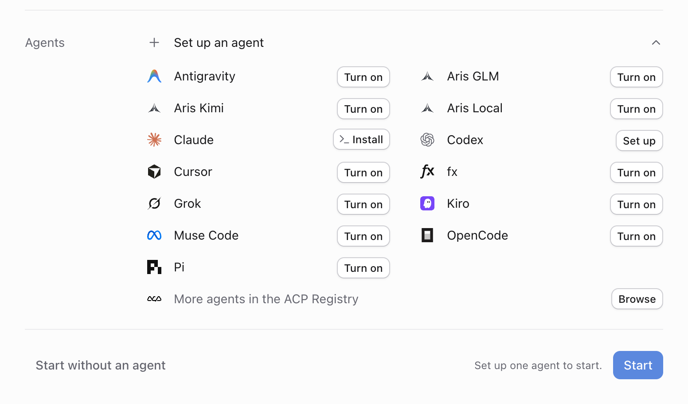

# Aris Code

Aris Code is a desktop coding agent built for security work, for Macs with Apple Silicon. This repository holds its installers and update files. More at [youraris.com/aris-code](https://youraris.com/aris-code).

## Download

**Mac** (Apple Silicon, M1 or newer): `Aris-Code-<version>-arm64.dmg` from the [latest release](../../releases/latest). Open it and drag Aris Code into Applications. After that, the app updates itself.

## Set up

### 1. Pick the model you chat with

Aris Code runs on a plan you already have. Set one up in **Settings → Providers**. The main ones:

| Provider | Runs on |
| --- | --- |
| Claude | Your Claude plan or an Anthropic API key |
| Aris Kimi | A Kimi Code API key |
| Aris GLM | A z.ai GLM Coding Plan API key |
| Codex | Your ChatGPT sign-in |
| Aris Local | Inkling 2 Mini or Aris 3.8-27B on your own Mac (see [Aris Local](#aris-local)) |

Claude, Aris Kimi, Aris GLM and Aris Local run through Claude Code. When it's missing, the Welcome screen and **Settings → Providers → Claude** install it with Anthropic's own installer.

### 2. Add your Aris key

The Aris key gives every provider the Aris knowledge graph (current CVEs, advisories and framework releases) and web search, and runs Image Studio on your Aris credits. It is not a model of its own: you still chat with one of the providers above.

1. Sign in at [youraris.com/account](https://youraris.com/account). Under **API keys**, name a key and choose **Create key**, then **Copy key**. The key is shown only once.
2. In Aris Code, open **Settings → Providers → Claude** and paste it into the **Aris key** field. Aris Kimi and Aris GLM have the same field; one is enough.

### 3. Start a chat

Pick the provider and model in the chat's model picker, then type.

## Aris Local

Aris Local runs a model on your Mac, with no per-token cost. In **Settings → Providers → Aris Local**, pick one:

- **Inkling 2 Mini**, by Thinking Machines: the faster one, on any Mac with 36 GB of memory or more. On a 48 GB Mac mini M4 Pro, the same coding task took 2.8 minutes on Inkling and 6.9 on Aris 3.8-27B.
- **Aris 3.8-27B**, ours: the alternative, and the one that also fits 32 GB Macs.

Setting one up installs uv, Aris Server and Claude Code if your Mac doesn't have them yet, downloads the model (about 18 GB for Inkling; 29 GB for the 27B on a 48 GB Mac, 16 GB on 32 GB) and keeps it running in the background. Switching keeps the current model answering until the new one is ready. It needs Apple Silicon and 32 GB of memory or more. [See the menu on youraris.com](https://youraris.com/aris-code#local).

## Privacy

With nothing set up, Aris Code's only automatic connection is its update check against GitHub. Everything else happens because you set it up: your providers, youraris.com with an Aris key, and what Aris Local setup installs and downloads. The [0.2.11 release notes](../../releases/tag/v0.2.11) have the details.

## Troubleshooting

**"Nothing is answering at 127.0.0.1:8484, so Aris Local has no model to talk to"**
The chat is on Aris Local, and Aris Server is not running on this computer. Set up a model as above, or pick another provider in the model picker.

**"Inkling 2 Mini isn't loaded: Aris Server on this Mac is running Aris 3.8-27B"** (or the other way round)
The chat names the model Aris Server ran before a switch. Pick the running model for this chat, or switch models in **Settings → Providers → Aris Local**.

**"Claude Agent CLI (`claude`) was not found on PATH"**
Claude Code is not installed. Install it from the Welcome screen, or run `curl -fsSL https://claude.ai/install.sh | bash`, then restart Aris Code.
