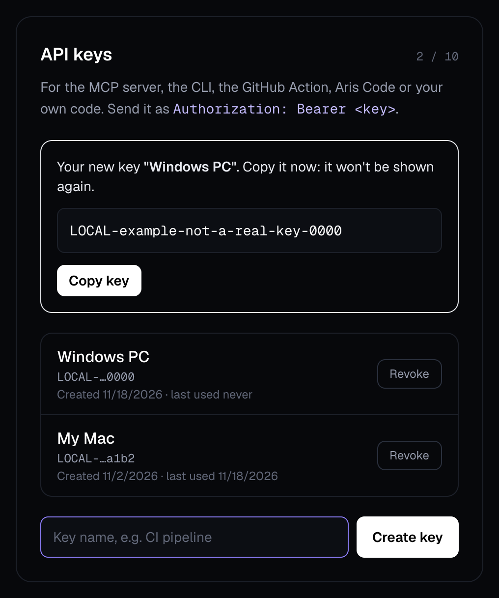
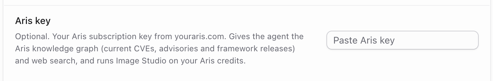
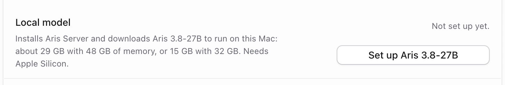

# Aris Code

Aris Code is a desktop coding agent built for security work, for macOS and Windows. This repository holds its installers and update files. More at [youraris.com/aris-code](https://youraris.com/aris-code).

## Download

- **Mac** (Apple Silicon, M1 or newer): `Aris-Code-<version>-arm64.dmg` from the [latest release](../../releases/latest). Open it and drag Aris Code into Applications.
- **Windows** (64-bit): `Aris-Code-<version>-x64.exe` from the [latest release](../../releases/latest). The installer is not code-signed yet: if Windows shows "Windows protected your PC", choose **More info**, then **Run anyway**.

After that, the app updates itself.

## Set up

### 1. Pick the model you chat with

Aris Code runs on a plan you already have. Set one up in **Settings → Providers**. The main ones:

| Provider | Runs on |
| --- | --- |
| Claude | Your Claude plan or an Anthropic API key |
| Aris Kimi | A Kimi Code API key |
| Aris GLM | A z.ai GLM Coding Plan API key |
| Codex | Your ChatGPT sign-in |
| Aris Local | Aris 3.8-27B on your own Mac (see [Aris Local](#aris-local)) |

Claude, Aris Kimi, Aris GLM and Aris Local run through Claude Code. On first launch, the Welcome screen checks for it and shows how to install it and sign in.

### 2. Add your Aris key

The Aris key gives every provider the Aris knowledge graph (current CVEs, advisories and framework releases) and web search, and runs Image Studio on your Aris credits. It is not a model of its own: you still chat with one of the providers above.

1. Sign in at [youraris.com/account](https://youraris.com/account). Under **API keys**, name a key and choose **Create key**, then **Copy key**. The key is shown only once.
2. In Aris Code, open **Settings → Providers → Claude** and paste it into the **Aris key** field. Aris Kimi and Aris GLM have the same field; one is enough.

### 3. Start a chat

Pick the provider and model in the chat's model picker, then type.

## Aris Local

Aris Local runs Aris 3.8-27B on your Mac, with no per-token cost. It needs Apple Silicon and 32 GB of memory or more. In **Settings → Providers → Aris Local**, choose **Set up Aris 3.8-27B**: Aris Code installs Aris Server, downloads the model (about 15 GB on a 32 GB Mac, 29 GB on 48 GB) and keeps it running in the background. On Windows, point Aris Local at Ollama instead.

## Troubleshooting

**"Nothing is answering at 127.0.0.1:8484" or "Could not reach 127.0.0.1:8484: connect ECONNREFUSED"**
The chat is on Aris Local, and Aris Server is not running on this computer. Set it up as above, or pick another provider in the model picker.

**"Claude Agent CLI (`claude`) was not found on PATH"**
Claude Code is not installed. Install it from the Welcome screen, or run `curl -fsSL https://claude.ai/install.sh | bash` on a Mac or `irm https://claude.ai/install.ps1 | iex` in Windows PowerShell, then restart Aris Code.

**"Windows protected your PC"**
Choose **More info**, then **Run anyway**. The installer is not code-signed yet.
